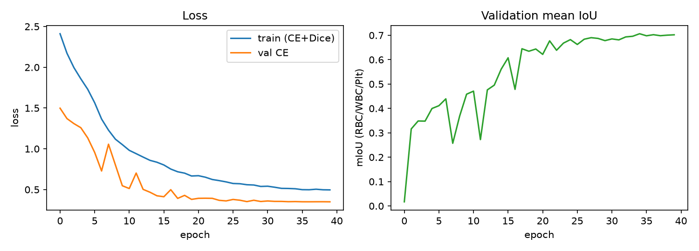
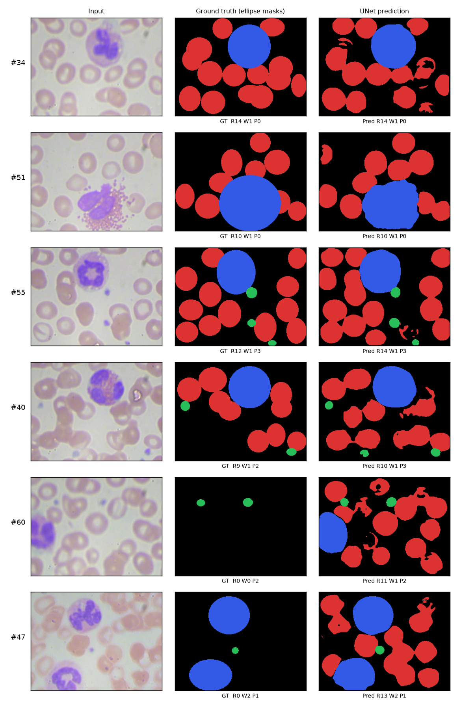
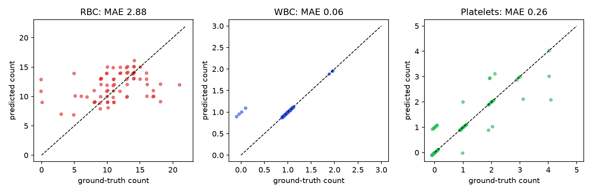
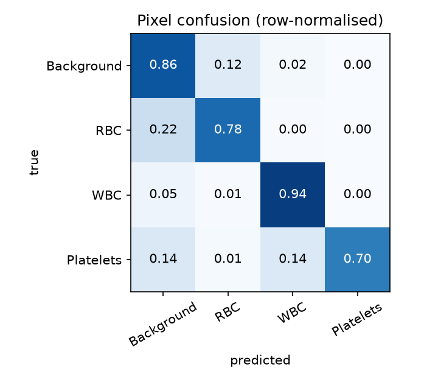

# 1. Introduction

A complete blood count requires enumerating red blood cells (RBC), white blood cells (WBC) and platelets. Done by hand under a microscope, it is slow and varies between observers. This project builds an automated hematology assistant: a **UNet** semantic-segmentation network labels every pixel of a peripheral blood-smear photomicrograph as background, RBC, WBC or platelet, and a post-processing step turns the predicted masks into per-class counts and a cell differential.

The objectives follow the project brief: implement a UNet on the free Kaggle/GitHub **BCCD** dataset, evaluate mean IoU, and produce automated cell counts, using only free resources (PyTorch, CPU or free Colab).

# 2. Dataset

BCCD contains 364 smear images (640 × 480 RGB) with Pascal-VOC bounding-box annotations for three classes. The official split was used unchanged:

| Split | Images | Mean RBC / image | Mean WBC / image | Mean platelets / image |
|---|---|---|---|---|
| Train | 205 | 11.6 | 1.04 | 1.02 |
| Validation | 87 | 11.1 | 1.00 | 0.95 |
| Test | 72 | 11.2 | 0.99 | 0.96 |

**Pixel masks.** BCCD provides bounding boxes, not pixel masks. Dense training and evaluation labels were therefore generated by drawing a filled **ellipse inscribed in each bounding box** (RBC first, then WBC, then platelets, so rarer classes are never hidden). All IoU/Dice figures below are measured against these ellipse masks, not against expert pixel annotations (see Limitations). Images and masks were resized to 320 × 240.

# 3. Method

**Architecture.** A standard 4-level UNet written from scratch: each level is two 3×3 convolutions with batch normalisation and ReLU; the encoder uses max-pooling, the decoder uses transposed convolutions and skip-connections; base width 16 channels, 1.94 M parameters, 4-class softmax output.

**Training.** Loss = class-weighted cross-entropy (weights 1 / 1 / 2 / 4 for background / RBC / WBC / platelets, to counter class imbalance) + soft Dice loss. AdamW, one-cycle learning-rate schedule (peak 2e-3), batch size 8, 40 epochs, seed 0. Augmentation: random horizontal / vertical flips and brightness / colour jitter. The checkpoint with the best validation mean IoU (over the three cell classes) was kept (0.706 on validation). Training took about 28 minutes on 2 CPU cores.

**Counting.** The predicted label map is converted to counts per class: WBC and platelets are counted as connected components above a minimum area; RBCs, which frequently touch, are split with a distance-transform watershed. The four RBC splitting parameters were tuned by grid search on the **validation** split only; the test split was used once for the reported numbers. The *cell differential* reported here is the proportion of RBC : WBC : platelets (the BCCD detection data carries no WBC sub-type labels, so a five-part WBC differential is not possible).

# 4. Results

All numbers are on the 72-image held-out test split.

| Metric | Background | RBC | WBC | Platelets |
|---|---|---|---|---|
| IoU | 0.768 | 0.615 | 0.816 | 0.570 |
| Dice | 0.869 | 0.761 | 0.899 | 0.726 |

Mean IoU over the three cell classes: **0.667**; mean Dice: **0.796**; pixel accuracy: 0.839.

**Automated counts** (predicted vs ground-truth count per image):

| | RBC | WBC | Platelets |
|---|---|---|---|
| Mean absolute error | 2.88 | 0.06 | 0.26 |
| Exact match | 12.5 % | 94.4 % | 75.0 % |
| Within ±1 cell | 40.3 % | 100 % | 98.6 % |
| Total true / predicted (72 images) | 805 / 850 | 71 / 75 | 69 / 74 |

**Differential** (share of all counted cells): predicted RBC 85.1 %, WBC 7.5 %, platelets 7.4 %, against ground truth 85.2 %, 7.5 %, 7.3 %.

{width=95%}

{width=75%}

{width=95%}

{width=55%}

# 5. Discussion

- **WBC** is segmented and counted almost perfectly (IoU 0.82, 100 % of images within ±1): WBCs are large, dark-purple and visually distinct.
- **Platelets** are small (about 10–40 pixels at 320 × 240); IoU is lower (0.57) mainly because a few pixels of misalignment matter a lot for tiny objects, yet counting is still good (98.6 % within ±1).
- **RBCs** have the highest count error. Cells overlap and clump, so a single connected blob may hold several cells, and watershed splitting is only approximate. The scatter plot shows the model tends to compress the range (under-counting very crowded images, over-counting sparse ones). Total counts are close (850 vs 805, +5.6 %), so the aggregate differential is accurate even though per-image RBC counts are noisy.
- **Label quality.** Some test images contain RBCs that were never annotated (e.g. test images #47 and #60 in the qualitative figure show ground-truth RBC count 0, although the cells are plainly visible and the model segments them). Three of 72 test images have zero annotated RBCs. Excluding those three, test results are slightly better: mean IoU 0.673, RBC IoU 0.634, RBC count MAE 2.52 (`outputs/test_metrics_clean_subset.json`). The main figures above keep all 72 images.

# 6. Limitations

1. **Pseudo ground truth.** Masks are ellipses derived from boxes. Real cell outlines are not perfect ellipses, so IoU against these masks understates segmentation quality in some places and overstates it in others; the numbers are not comparable with benchmarks that use expert pixel masks.
2. **Incomplete annotations** in BCCD (above) penalise correct predictions and inflate RBC count error.
3. **Border cells.** Ground-truth counts include partially visible cells at the image edge; the counting rule does not specifically handle them.
4. **Single run.** One training run with one seed and one dataset split; no confidence intervals. Hyper-parameters (loss weights, augmentation) were not searched.
5. **Not a clinical tool.** Results come from one small public dataset and must not be used for diagnosis.

# 7. Conclusion

A from-scratch UNet trained on BCCD reached mean IoU 0.667 (cells) on the test split, counted WBCs and platelets almost exactly, and reproduced the RBC : WBC : platelet proportions to within about one percentage point of ground truth. Future work: pixel-accurate annotations or a refined mask-generation step (e.g. colour-based refinement inside each box), a pretrained encoder, instance-aware loss for touching RBCs, and a WBC sub-type classifier on top of the segmentation.

# 8. Reproducibility

Code, trained weights, metrics and figures are in the accompanying folder; see `README.md` for the commands. Dataset: BCCD (https://github.com/Shenggan/BCCD_Dataset, MIT licence). Framework: PyTorch 2.15, scikit-image, SciPy, OpenCV.
